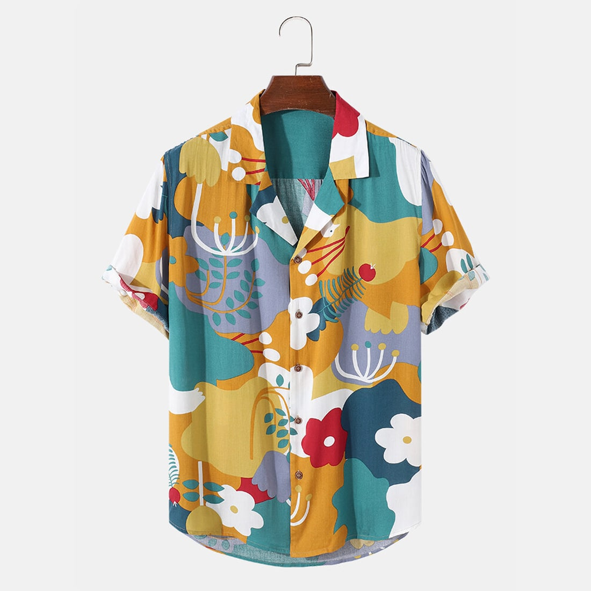

# ShopEase: E-commerce Website

A responsive online clothing store front-end built with **plain HTML, CSS and JavaScript** (no frameworks, no build tools). Prices are in Ghana cedis (₵).

This README is the full guide for anyone in the group who wants to understand, continue or **rebuild the project from scratch**. The code files themselves only carry short labels so you can find things quickly. All the explanations are here.

## Contents

1. [Getting started](#1-getting-started)
2. [Project structure](#2-project-structure)
3. [Finding things in the code](#3-finding-things-in-the-code)
4. [Design system](#4-design-system)
5. [How each section works](#5-how-each-section-works)
6. [How the mobile menu works](#6-how-the-mobile-menu-works)
7. [Rebuilding the home page from scratch](#7-rebuilding-the-home-page-from-scratch)
8. [Building a new page](#8-building-a-new-page)
9. [Common tasks](#9-common-tasks)
10. [Team rules](#10-team-rules)
11. [Credits](#11-credits)

---

## 1. Getting started

1. Clone or download the project:

   ```bash
   git clone <repository-url>
   ```

2. Open the folder in **VS Code**.
3. Open `index.html` in a browser. Either:
   - double-click the file, or
   - (recommended) install the **Live Server** extension, right-click `index.html` and choose **Open with Live Server**. The page reloads automatically every time you save.

No installation, internet connection or server is needed. **Everything (fonts, icons, images) is stored locally, so the site works offline.**

---

## 2. Project structure

```text
Ecommerce-Website/
├── index.html        Home page (complete: use it as the template)
├── shop.html         Shop page            (to do)
├── sproduct.html     Single product page  (to do)
├── blog.html         Blog page            (to do)
├── about.html        About page           (to do)
├── contact.html      Contact page         (to do)
├── cart.html         Shopping cart page   (to do)
├── style.css         ONE stylesheet shared by every page
├── script.js         ONE script shared by every page (mobile menu)
├── fonts/            League Spartan font file (loaded in style.css)
└── img/
    ├── icons/        SVG icons: cart, stars, menu, close, social media
    ├── products/     Product photos: f1–f8 (Featured), n1–n8 (New Arrivals)
    ├── banner/       Background images for banners
    ├── features/     The 6 feature-box icons on the home page
    ├── pay/          App Store / Google Play badges, payment logos
    ├── blog/         Blog post images
    ├── people/       Team / testimonial photos
    ├── about/        About page images and video
    └── shopease_logo.png
```

---

## 3. Finding things in the code

### Numbered labels

The page is divided into **numbered sections**. The **same number** is used in `index.html` and `style.css`, so "section 6" means the product cards in both files.

| # | Section | HTML element | Where it's used |
| --- | --- | --- | --- |
| 1 | Font & reset | (CSS only) | Whole site |
| 2 | Global styles | (CSS only) | Headings, paragraphs, buttons, spacing |
| 3 | Header & navigation | `<section id="header">` | **Every** page |
| 4 | Hero | `<section id="hero">` | Home page |
| 5 | Features | `<section id="feature">` | Home page |
| 6 | Products | `<section class="product1">` | Home page (twice), shop page |
| 7 | Banner | `<div id="banner">` | Home page |
| 8 | Small banners | `<section id="sm-banner">` | Home page |
| 9 | Banner 3 | `<section id="banner3">` | Home page |
| 10 | Newsletter | `<section id="newsletter">` | Home page |
| 11 | Footer | `<footer>` | **Every** page |
| 12 | Media queries | (CSS only) | Tablet and phone layouts |

The labels look like this:

```css
/* ==================== 6. PRODUCTS  (.product1) ==================== */   ← main section
/* --- Add-to-cart button --- */                                          ← part of a section
```

```html
<!-- ==================== 6. PRODUCTS: FEATURED ==================== -->
```

Inside the media queries (section 12), each override is labelled with the section it changes, e.g. `/* --- 6. Products --- */`.

### Quick ways to jump around in VS Code

| Shortcut | What it does |
| --- | --- |
| `Ctrl + F`, type `6. PRODUCTS` | Jump to a section's label in the open file |
| `Ctrl + Shift + O` | List every CSS selector / HTML element in the file. Type to filter (e.g. `.cart`) |
| `Ctrl + Shift + F` | Search all files, e.g. find every place `#c71585` is used |
| `Ctrl + P` | Open a file by typing its name |

---

## 4. Design system

### Font

**League Spartan**, loaded from `fonts/` (works offline). It is a variable font: one file covers every weight from 100 (thin) to 900 (black). Backup font: Arial.

### Colors

| Color | Used for |
| --- | --- |
| `#c71585` | **Brand pink**: active links, prices, hover effects, hero title |
| `#222` | Headings |
| `#1a1a1a` | Navigation links, product names |
| `#465b52` | Body text, social icons |
| `#cce7d0` | Light green borders around cards and boxes |
| `#e8f6ea` | Add-to-cart button background |
| `#041e42` | Newsletter background (navy) |
| `#088178` | Newsletter "Sign Up" button (teal) |
| `#e3e6f3` | Mobile slide-out menu background |

### Reusable classes

| Class | What it does | Example |
| --- | --- | --- |
| `.section-p1` | Standard inner spacing (40px top/bottom, 80px sides) | `<section class="section-p1">` |
| `.section-m1` | 40px space above and below | `<div class="section-m1">` |
| `button.normal` | Solid white button | `<button class="normal">Sign Up</button>` |
| `button.outline` | Transparent button with white border (for dark images) | `<button class="outline">Learn More</button>` |

### Naming conventions

- `#id`: a whole section used **once** per page (`#header`, `#hero`). Some ids are used by `script.js`, so don't rename them.
- `.class`: a piece that appears **many times** (`.pro`, `.banner-box`).

### Responsive breakpoints

The CSS is **desktop-first**: the normal rules are for large screens, and the media queries at the bottom override them for smaller screens.

| Screen width | Layout |
| --- | --- |
| above 799px | Desktop: menu in a row, ~5 product cards per row |
| 799px and below | Tablet: slide-out menu, cards centered, big promo boxes stacked |
| 477px and below | Phone: 1 product per row, smaller headings, full-width form |

A phone also counts as "799px and below", so **phone rules are applied on top of the tablet rules**. Test changes with browser DevTools: **F12 → toggle device toolbar (Ctrl + Shift + M)**.

---

## 5. How each section works

### 1. Font & reset

- `@font-face` loads the local font file.
- The `*` rule removes the browser's default margins and padding, so every gap on the page is one we set on purpose.
- `box-sizing: border-box` makes `width` **include** padding and border. A `200px` box stays 200px even after you add padding.
- `scroll-behavior: smooth` animates in-page links such as `href="#newsletter"`.

### 2. Global styles

Default sizes and colors for `h1`, `h2`, `h4`, `h6` and `p`, plus the reusable classes from [section 4](#reusable-classes). Sections override these when needed (for example white headings on dark banners).

### 3. Header & navigation

- `display: flex` + `justify-content: space-between` puts the logo on the far left and the menu on the far right.
- `position: sticky; top: 0` keeps the header at the top while scrolling, and `z-index: 99` keeps it above the page content.
- **Active / hover underline:** `#navbar li a::after` draws a 30px × 2px pink line under a link. `::after` creates an extra empty element after the link text. It needs `content: ''` to appear, and the `li` has `position: relative` so the line is placed relative to its own link. `left: 20px` lines it up with the `li`'s 20px padding.
- Mark the current page with `class="active"` on its link.
- `#mobile` (phone cart + menu icons) and `#close` (X button) are hidden on desktop and shown by the tablet media query. See [section 6](#6-how-the-mobile-menu-works).

### 4. Hero

- The model photo is a **CSS background** (`#hero { background-image: url('img/hero1.png') }`), not an ``. `background-size: contain` shows the whole image without cropping.
- `display: flex; flex-direction: column` stacks the text vertically. `justify-content: center` centers it vertically, and `align-items: flex-start` keeps it on the left.
- The "Shop Now" button uses `img/button.png` as its background shape. The larger right padding (`80px`) leaves room for the arrow in the image.

### 5. Features

- Six `<div class="fe-box">` boxes in a flex row with `flex-wrap: wrap`, so they move onto new lines on narrow screens.
- Each label gets its own background color using `:nth-child(n)`:

  | Box | Label | Color |
  | --- | --- | --- |
  | 1 | Free Shipping | `#cce7d0` (green) |
  | 2 | Online Order | `#f6dbf6` (pink) |
  | 3 | Save Money | `#d1e8f2` (light blue) |
  | 4 | Promotion | `#cdebbc` (lime) |
  | 5 | Happy Sells | `#cdd4f8` (lavender) |
  | 6 | 24/7 Support | `#fff2e5` (peach) |

  If you add a 7th box, add a `#feature .fe-box:nth-child(7) h6` rule for its color.

### 6. Products

`product1` is a **class**, not an id, because it is used twice on the home page (Featured + New Arrivals).

One product card:

```html
<div class="pro">
  
  <div class="des">
    <span>Zara</span>                          <!-- brand -->
    <h5>Abstract Print Resort Shirt</h5>       <!-- name -->
    <div class="star">…5 star icons…</div>    <!-- rating -->
    <h4>₵189</h4>                              <!-- price -->
  </div>
  <a href="#" class="cart"></a>
</div>
```

- `.pro-container` is a wrapping flex row. Each card is `width: 18%` (about 5 per row) with `min-width: 200px` so cards never get too thin.
- **Round cart button:** `.pro` has `position: relative`, and `.cart` has `position: absolute; bottom: 20px; right: 10px`, which pins the button to the card's bottom-right corner. `border-radius: 50%` makes it a circle.
- `.pro > img` uses `>` ("direct child") so the rule only affects the product photo, not the star or cart icons further inside.

### 7. Banner

Full-width strip. The image is a CSS background with `background-size: cover` (fills the strip; edges may be cropped). Flexbox centers the text both ways.

### 8. Small banners

Two `.banner-box` divs. The second also has `.banner-box2`, which **only** changes the background image; everything else is inherited from `.banner-box`. Hovering a box turns its button pink.

### 9. Banner 3: dark overlay

Three promo boxes. To keep white text readable on any photo, each background has **two layers**: a see-through black gradient drawn on top of the photo:

```css
background-image:
  linear-gradient(rgba(0, 0, 0, 0.5), rgba(0, 0, 0, 0.5)),  /* layer 1: 50% black */
  url('img/banner/sales.jpg');                             /* layer 2: photo */
```

The first layer listed is drawn on top. Change `0.5` (in both places) to make it lighter (`0.3`) or darker (`0.7`). When you change a photo in `.banner-box2` / `.banner-box3`, keep the gradient line.

### 10. Newsletter

- Navy background color with a decorative pattern image on top.
- The input and button look like one joined control: the input's **right** corners and the button's **left** corners are squared off (`border-*-radius: 0`).
- The input uses `type="email"` so phones show the @ keyboard. It isn't connected to a server yet.

### 11. Footer

- `footer` is a wrapping flex row of `.col` columns. Each column stacks its contents with `flex-direction: column`.
- `.copyright` has `width: 100%`, so it takes a full row of its own at the bottom.
- **Social icons** are local SVG files in `img/icons/`, already colored `#465b52` inside the file. Each sits in a 32px outlined circle.
- On hover the circle fills pink and lifts 3px. An `` can't change color with CSS, so the icon is turned white with `filter: brightness(0) invert(1)` (first make it black, then invert black to white).

### 12. Media queries

See [Responsive breakpoints](#responsive-breakpoints). Only the properties that change are repeated inside the media queries, and each override is labelled with its section number.

---

## 6. How the mobile menu works

This uses **CSS and JavaScript together**:

1. On screens 799px and below, CSS turns `#navbar` into a vertical panel with `position: fixed` and **`right: -300px`**, which parks it just off the right edge of the screen (hidden).
2. When the menu icon (`#bar`) is tapped, `script.js` **adds** the class `active` to `#navbar`.
3. The CSS rule `#navbar.active { right: 0px; }` moves the panel on-screen, and `transition: 0.3s` animates it so it slides in.
4. Tapping the X (`#close`) **removes** `active`, and the panel slides back out.
5. `e.preventDefault()` stops the `href="#"` links from jumping the page back to the top.

**Required HTML ids** (keep them on every page):

| id | Element |
| --- | --- |
| `navbar` | The `<ul>` of menu links |
| `bar` | Menu (hamburger) icon inside `<div id="mobile">` |
| `close` | The X `<li>`, last item inside `#navbar` |

`#navbar #close` is used in the CSS (instead of just `#close`) because the more general `#navbar li` rule would otherwise force it to `position: relative` and break its corner placement.

---

## 7. Rebuilding the home page from scratch

Build in this order. After each step, open the page and check it before moving on.

1. **Set up the folders:** create `fonts/`, `img/` (with the sub-folders from [section 2](#2-project-structure)), and add the font file and images.
2. **HTML skeleton:** create `index.html` with:

   ```html
   <!doctype html>
   <html lang="en">
     <head>
       <meta charset="UTF-8" />
       <meta name="viewport" content="width=device-width, initial-scale=1.0" />
       <title>ShopEase | Home</title>
       <link rel="stylesheet" href="style.css" />
     </head>
     <body>
       <!-- sections go here -->
       <script src="script.js"></script>
     </body>
   </html>
   ```

   The `viewport` meta tag is required for the phone layouts to work. The `<script>` goes last so the HTML exists before the script runs.
3. **CSS sections 1–2:** font, reset and global styles.
4. **Header (3):** logo + `<ul id="navbar">` links (desktop only for now).
5. **Hero (4) → Features (5) → Products (6) → Banner (7) → Small banners (8) → Banner 3 (9) → Newsletter (10) → Footer (11):** for each one, write the HTML section with its numbered label, then its labelled CSS section. Use [section 5](#5-how-each-section-works) as the reference.
6. **Media queries (12):** shrink the browser and fix each section at 799px, then at 477px.
7. **Mobile menu:** add `#mobile`, the `#close` `<li>`, the menu CSS and `script.js` ([section 6](#6-how-the-mobile-menu-works)).
8. **Final check:** every image has `alt` text, no `$` signs remain (use `₵`), and the page works with Wi-Fi turned off.

---

## 8. Building a new page

1. Create the file (e.g. `shop.html`) and copy from `index.html`:
   - the whole `<head>` (change the `<title>`),
   - **section 3** (header),
   - **section 11** (footer),
   - the `<script src="script.js"></script>` line.
2. In the header, move `class="active"` to the current page's link:

   ```html
   <li><a class="active" href="shop.html">Shop</a></li>
   ```

3. Put the page's own sections between the header and the footer, each with a numbered label (13, 14 …).
4. Add their styles to `style.css` as new numbered sections **above** section 12. Add any tablet/phone rules **inside** the existing media queries, labelled with the same number.

---

## 9. Common tasks

**Add a product:** copy one whole `<div class="pro"> … </div>` block in section 6. Change the image, `alt`, brand (`<span>`), name (`<h5>`) and price (`<h4>₵…</h4>`). Put the photo in `img/products/`.

**Change a banner image:** banner backgrounds are set in `style.css` (sections 7–9), not in the HTML. Change the `url('img/banner/…')`.

**Change the brand color:** search all files (`Ctrl + Shift + F`) for `#c71585` and replace it.

**Add a social media link:** in the footer's "Social icons" block, replace `href="#"` with the real address (e.g. `https://instagram.com/yourshop`). For WhatsApp use `https://wa.me/233XXXXXXXXX`.

**Add a social media icon:** get the free SVG from [Font Awesome](https://fontawesome.com/search?o=r&m=free&f=brands), save it in `img/icons/`, add `fill="#465b52"` to its `<path>`, and copy one of the existing `<a></a>` lines in the footer.

---

## 10. Team rules

1. **No CDN or online links** (Font Awesome, Google Fonts, Bootstrap …). The site must work without internet. Download files into `fonts/` or `img/` instead.
2. **Every image needs `alt` text** describing it.
3. **One stylesheet, one script.** Don't create page-specific CSS files.
4. **Label what you add** with the same numbered format, and explain anything new in this README rather than in long code comments.
5. **Before you start working:** `git pull`. **When you finish:** `git add .`, `git commit -m "short description"`, `git push`.

---

## 11. Credits

- Social media icons: [Font Awesome Free](https://fontawesome.com) (CC BY 4.0). The license note is kept inside each SVG file. Don't remove it.
- Font: League Spartan (SIL Open Font License).
